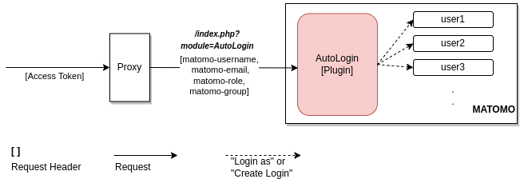
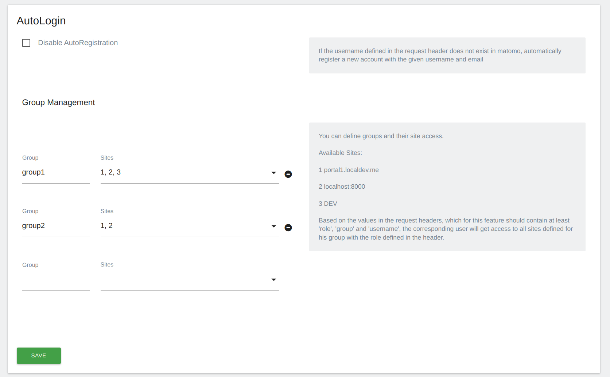

# Matomo AutoLogin Plugin

## Description

The Matomo AutoLogin Plugin adds new authentication and registration options by using incoming HTTP headers. It offers the following features:

1. **Login**: Matomo will automatically sign in users by extracting their username and role information from the incoming HTTP header. If a user with that username already exists in Matomo, they will be logged in with the specified role (View, Write, Admin, or Super User).
2. **Registration**: If the username provided in the HTTP header does not exist in Matomo, this plugin will register a new user with that username.
3. **Groups**: This plugin also allows users to be assigned to specific groups based on the group information provided in the HTTP header. Users gain access to all sites available to their assigned group. Groups can only be created by Superusers in the system settings.

AutoLogin trusts the identity headers only when a request passes all of these checks:

* The plugin is enabled in the system settings (it is off after installation).
* The request comes from an address listed under "Trusted proxies". AutoLogin compares against `REMOTE_ADDR` and ignores `X-Forwarded-For`.
* The request carries the configured shared secret in the `matomo-autologin-secret` header.

Possible setup:



In this setup, all traffic towards Matomo goes through a proxy. The proxy validates an incoming access token from the user, extracts the username, role etc. from it and sets the `matomo-*` headers. The proxy must remove or overwrite every `matomo-*` header sent by the client, including underscore spellings such as `matomo_username` (some servers map both spellings to the same PHP variable, and AutoLogin can only detect this under mod_php), and Matomo must not be reachable without going through the proxy. With nginx in front of PHP-FPM, keep `underscores_in_headers` off (the default). With it on, a client-sent `matomo_username` reaches PHP as the same header and can replace the value the proxy set.

## Configuration

Only a Superuser can configure the AutoLogin plugin, under Administration > System > General settings > AutoLogin.

The four settings that gate authentication live in `config.ini.php` under an `[AutoLogin]` section,
not in the database. They can therefore be provisioned during a deployment, and a Super User who
takes over the web UI cannot rewrite them to let themselves back in.

```ini
[AutoLogin]
enabled = 1
sharedSecret = "0f3a...32-chars-or-more"
trustedProxies = "127.0.0.1"
allowSuperUserRole = 0
```

Or equivalently, without editing the file by hand:

```bash
./console config:set --section="AutoLogin" --key="enabled" --value=1
./console config:set --section="AutoLogin" --key="sharedSecret" --value="$(openssl rand -hex 32)"
./console config:set --section="AutoLogin" --key="trustedProxies" --value="127.0.0.1"
./console config:set --section="AutoLogin" --key="allowSuperUserRole" --value=0
```

| Setting | Where | Default | Purpose |
|---|---|---|---|
| `enabled` | config.ini.php | `0` | Every request is rejected while this is off. |
| `sharedSecret` | config.ini.php | empty | Value the proxy sends in `matomo-autologin-secret`. At least 32 characters of letters, digits, `-` or `_`, e.g. `openssl rand -hex 32`. A value that does not meet this is treated as unset. |
| `trustedProxies` | config.ini.php | empty | One or more IP addresses or ranges, separated by commas or newlines, e.g. `10.0.0.5` or `10.0.0.0/24`. |
| `allowSuperUserRole` | config.ini.php | `0` | When off, the `superuser` role header is rejected and existing superusers cannot sign in through AutoLogin. |
| Disable AutoRegistration | UI / database | off | When on, unknown usernames are rejected instead of created. |
| Group Management | UI / database | empty | Maps a `matomo-group` header value to a set of sites. |

Booleans must be written as `1` or `0`: Matomo casts the raw INI string, and any non-empty value
other than `0` (including the word `false`) reads as true.

Request headers set by the proxy:

| Header | Required | Value |
|---|---|---|
| `matomo-autologin-secret` | yes | The shared secret |
| `matomo-username` | yes | Matomo login |
| `matomo-email` | for new users | Email used for AutoRegistration |
| `matomo-role` | no | `view`, `write`, `admin`, `noaccess` or `superuser`. Any value other than `superuser` removes superuser access. |
| `matomo-group` | no | A group defined in Group Management |



## Upgrading from 0.2.x

Version 0.3.0 fixes an authentication bypass (see the [security advisory](https://github.com/inventage/matomo-autologin-plugin/security/advisories)). After the update AutoLogin rejects all requests until you enable it, set a shared secret and list your proxy addresses. Configure the proxy to send the secret header first, then enable the plugin. Turn on "Allow superuser role" only if your proxy assigns the superuser role.

## Installation
There are two options for installing the AutoLogin plugin:
* Install it via the Matomo Marketplace.
* Put the php files and the plugin.json file in /plugins/AutoLogin and activate it in the Matomo's system settings.

## Known issue
A random secure password is set for each automatically registered user. This means that automatically registered SuperUsers will not be able to make changes to system settings unless they manually change their password. Alternatively, disabling password confirmation for system settings changes would be another solution: https://forum.matomo.org/t/how-to-disable-confirmpassword-feature/49834/3

## License
MIT 

